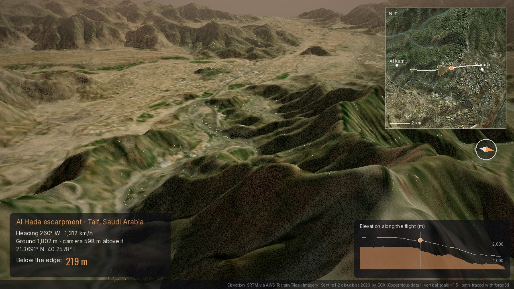

# Al Hada: flying over the edge of the Hejaz escarpment

A 20-second flight off the Taif plateau in Saudi Arabia.

- **Route:** it starts above Al Hada at about 1,970 m, crosses the rim where the Al Hada road begins its hairpins, then glides down the escarpment towards the Al Karr valley, about 1,200 m lower. That is 7.3 km in 480 frames.
- **Rendering:** each frame is path-traced with [forge3d](https://pypi.org/project/forge3d/) from free elevation data and a cloud-free Sentinel-2 mosaic.



## The look

- **Colour:** the ground carries **Sentinel-2 cloudless 2023** colour.
- **Steep faces** (slopes over about 32°) blend to a warm granite tone, the same trick used in the Yosemite forge3d flythroughs. It makes the escarpment's ravines and spurs read as rock rather than as a flat photo draped over hills.
- **Light and grade:** an afternoon sun from the south-south-west gives side light across the westward flight. The HUD adds an evening sky, haze towards the horizon and a warm grade.
- **Vertical scale ×1.5:** the elevation source (SRTM, 30 m) rounds off the cliffs, so the relief is exaggerated by 1.5. The numbers in the HUD are real metres.

## The data

- **Elevation:** AWS Terrain Tiles ("terrarium" PNG), zoom 13. Here the source is SRTM.
- **Imagery:** Sentinel-2 cloudless 2023 by EOX, zoom 14 (about 9 m per pixel).
- **Grid:** both are reprojected to UTM zone 37N on a 10 m grid, a 40 × 33 km window from the Taif plateau to the lowlands towards Makkah.

## How it works

1. **`01_download.py`** fetches and stitches the tiles into `data/alhada_dem_s2.bin` (about 18 MB, already included).
2. **`alhada_common.py`** reprojects the data to UTM (cached in `data/alhada_utm.npz` on first run). It also holds:
   - the colours
   - the route: a smooth Catmull-Rom path through waypoints, sampled at equal steps
   - the altitude profile: it holds over the plateau, then eases down the escarpment, always at least 380 m above the highest ground nearby
   - the camera dip, which tips down to 30° as it goes over the rim
3. **`02_still.py`** renders one frame to check the look.
4. **`03_flight.py`** path-traces every frame. forge3d's path tracer has a 512 MiB ceiling, so each frame gets a 20 × 20 km window centred 6 km ahead of the camera.
5. **`04_hud.py`** grades the frames, draws the overlay in Pillow and encodes the MP4. The overlay has:
   - a minimap with the view cone
   - an elevation profile of the route with the camera on it
   - live heading, speed, ground height and height above it
   - "below the edge": how far the ground has dropped since the rim

```powershell
python -m venv .venv
.venv\Scripts\Activate.ps1
pip install -r requirements.txt

python 02_still.py --frame 200      # check one frame (going over the edge)
python 03_flight.py                 # 480 frames; can be stopped and restarted
python 04_hud.py                    # -> output\al_hada_flight.mp4
```

Rendering takes about 16 s per frame on one CPU core at 1280 × 720. To use two cores, run two copies side by side:

```powershell
python 03_flight.py --start 0 --step 2
python 03_flight.py --start 1 --step 2
```

## Limits

- **Resolution:** the 10 m imagery and 30 m elevation look soft close to the camera, which is why the flight stays 400–650 m above the ground.
- **Speed:** 7.3 km in 20 s is about 1,300 km/h, much faster than any drone.
- **Exaggeration:** the vertical scale is ×1.5, so the escarpment is real but its steepness is boosted.

## Sources

- Elevation: SRTM via Terrain Tiles on AWS (Mapzen / Tilezen)
- Imagery: Sentinel-2 cloudless 2023 by EOX IT Services GmbH (contains modified Copernicus Sentinel data 2023), CC BY-NC-SA 4.0
- Rendering: forge3d 1.44 (path tracer)
- Fonts: Inter, Oswald, Source Serif 4 (SIL OFL 1.1)

Inspired by a forge3d flythrough of Yosemite Valley from Milos Popovic's forge3d community.

## Licence

Code: MIT. Data and video: see `DATA_LICENSE.md`. The Sentinel-2 imagery is CC BY-NC-SA 4.0, so the video is non-commercial and shared alike.
